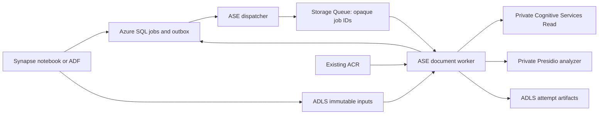

# ASE document samples and Synapse jobs

The existing VM notebooks remain direct ASE API examples. Their annotation and
redaction defaults are unchanged. `ase_document_tools.py` now also accepts an
explicit OCR provider for Word processing; omitting it retains the existing
Tesseract behavior. Optional text/image transformation callbacks are used only
by the new worker.

The **new, opt-in** [`synapse_worker`](synapse_worker) sample separates job
orchestration from document execution:



**Synapse needs private SQL and ADLS access, not an HTTP route to ASE.** A
successful VM call does not establish Spark routing, DNS, or identity.
Synapse/ADF submit references and monitor SQL; the worker handles OCR, local
rendering, conversion, and reconstruction. Cosmos DB is not needed. No new
Azure service instance is provisioned.

## Status and release gates

This is an implementation sample, **not an installed or production-accepted
service**. Configuration starts paused. Actual Azure Government endpoints,
principal mappings, private paths, OCR API availability, confidence calibration,
and synthetic service acceptance must be verified before activation. Do not
enable this for untrusted public uploads without an already approved content
inspection and isolation policy.

The supplied `synapse_worker/uv.lock` was generated normally against PyPI.
Locked installation and all 42 worker plus 20 focused legacy tests pass
without skips on Linux Python 3.10 through 3.14. This covers XLSX, PDF, raster
images, Word, mocked OCR/SQL boundaries, child crashes, lost leases, and hard
job deadlines. Ruff checks and wheel builds pass. The same 62 tests also pass
on Windows Python 3.13 with declared-range native dependencies.

The original Windows environment still cannot reach the PyPI artifact CDN.
An isolated Linux build host completed normal resolution and the full locked
matrix; the genuine generated lock was transferred with SHA-256 verification.
There are no alternate indexes, dependency-metadata overrides, lowered
requirements, or disabled certificate checks.

The worker image also builds and runs offline as non-root with the shipped
paused configuration; real LibreOffice DOC annotation/redaction/sanitization
passes. Production base-image approval, real SQL integration and Government
acceptance are deployment gates. Local checks do not prove private networking,
managed identities, OCR quality or permissions in your tenant.

## Formats and operations

| Input | Annotate | Redact | Sanitize |
| --- | --- | --- | --- |
| Native/scanned PDF | Original PDF plus visible rectangle annotations and sidecar | Fresh image-only PDF | Fresh image-only PDF with labels |
| TXT | Original bytes plus code-point annotation sidecar | TXT with `[REDACTED]` | TXT with file-scoped labels |
| Supported DOCX / legacy DOC | Highlighted DOCX | Fresh rebuilt DOCX | Fresh rebuilt DOCX with labels |
| Value-focused XLSX | Rebuilt XLSX with cell highlighting and sidecar | Rebuilt XLSX | Rebuilt XLSX with labels |
| PNG / JPEG / TIFF | Newly encoded, visibly marked same-format image | Newly encoded same-format image | Newly encoded same-format image with labels |

`sanitize` is **pseudonymization**, not guaranteed anonymity: repeated detected
values share labels within one file; the mapping resets for the next file.
Explicit parenthetical person aliases such as `Mary Smith (Mary)` can share a
label. Similar names alone do not prove identity. Ambiguous first-name or
initial/surname variants stay separate and generate `uncertain_aliases`.
Same-spelling people cannot reliably be distinguished without additional
evidence; this is not a general coreference resolver.

Annotation retains PII and must receive the same protection as the original.
Redacted PDFs lose native text/searchability, accessibility, vectors, and some
layout fidelity. DOCX rebuilds preserve only the existing helper's supported
content. XLSX outputs are **values only**: original formatting, metadata,
comments, links, defined names, and hidden state are not preserved. Formulas
and unsupported advanced features are rejected, not evaluated or silently
discarded. Sanitized sheet names are neutral; all supported sheets and cells
are scanned, including hidden ones. TIFF frames are all processed.

See the [deployment and operations runbook](synapse_worker/DEPLOYMENT.md) for
the exact supported subset, bounds, keyless identity matrix, installation,
verification, private dependency delivery, troubleshooting, and rollback.

The [Synapse notebook](synapse_worker/examples/synapse_document_jobs.ipynb)
and [ADF pipeline](synapse_worker/examples/adf_pipeline.json) demonstrate
submission, terminal-status monitoring and complete-result selection.

## Local checks

From `docs\samples\ASE\synapse_worker`, in an approved build environment:

```powershell
uv lock --check
uv sync --locked --extra worker --group dev
uv run pytest -q
uv run ruff check src tests scripts examples
uv build --wheel
```

Keep `uv.lock` with the sample. Regenerate it with `uv lock` when dependencies
change; never manufacture a lock.
The wheel has no mandatory dependencies for Synapse. The `worker` extra adds
Azure/native document dependencies; Spark does not need those dependencies.

Standard-library checks can also run from the repository root:

```powershell
python -m unittest discover -s docs\samples\ASE\synapse_worker\tests -v
python -m unittest discover -s docs\samples\ASE\tests -p test_document_tools.py -v
```

Native-format tests skipped for missing libraries are **not release evidence**.
The original full ASE test discovery also has pre-existing references to
absent `example_*.ipynb` filenames; those tests need their separate baseline
repair and have not been changed as part of this sample.
